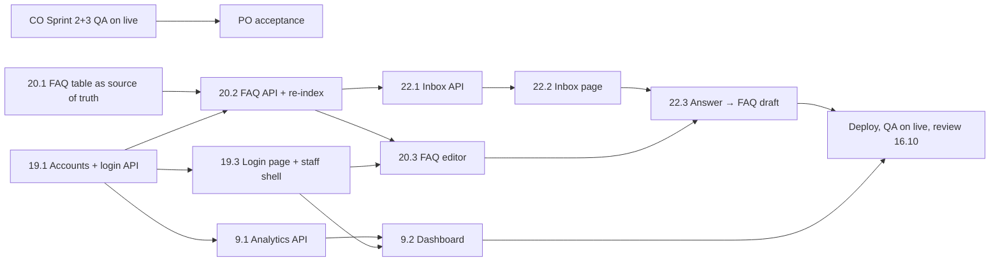

# Sprint 4 — tasks

**Sprint:** 10.10 – 16.10.2026, review and retro on Friday 16.10.

**Sprint goal:** Sprints 2 and 3 are accepted on the live site, and the admissions office has its own staff area: an officer logs in, edits the FAQ the assistant answers from, answers the questions the assistant could not, and sees what applicants ask.

**Stories:** US19 Staff Login and Roles, US20 FAQ Management, US21 Catalogue and Checklist Management, US22 Unanswered Question Inbox, US9 Admissions Analytics Dashboard, plus the carry-over: acceptance of US8, US10–US18 on the live site. Story cards are rows in `docs/table.xlsx`; acceptance scenarios are below.

**US21 is in this sprint.** A first plan moved it to Sprint 5 because `catalogue.json` was imported on every API start and would overwrite staff edits; it was done here the same way US20 moved the FAQ: the database became the source of truth and the start import only fills an empty catalogue (`--if-empty`).

## Team

The whole sprint is done by **Serdar** (AI/IS developer). The Product Owner (Askhat) accepts the stories at the review.

## Where we were (15.10.2026)

- Sprint 3 was built and checked locally, but no story of Sprint 2 or 3 was accepted, because none was checked on a deployed environment ([sprint-3-review.md](sprint-3-review.md)).
- Since 13.10 the site is live on an Oracle Cloud Always Free VM (https://193-123-95-102.sslip.io) and every push to `main` is deployed automatically (`deploy/oracle-vm/README.md`). The retro action "deploy first" is done.
- There was no staff area, login or staff role. The data the staff stories show already existed: `chat_turn` (kept 30 days), `answer_feedback`, `admissions_followup` (unanswered questions).
- The FAQ lived in `backend/app/data/faq.json` and was re-indexed from the file on every API start.

## Scope for one developer

| Story | Built | Cut (Sprint 5 backlog) |
| ----- | ----- | ---------------------- |
| US19 | Staff accounts (script only, no sign-up), scrypt hashes (standard library, no new dependency), HttpOnly session cookie on `/api/staff` for 8 h, `require_staff`, 5 failed logins / 15 min per account and IP, roles `admin` / `officer` | — |
| US20 | `faq_item` table as the source of truth, staff API, publish / unpublish / retire, single-item re-index, editor with EN/RU/KK tabs | Change history table (only `updated_by` / `updated_at` are kept) |
| US22 | Grouped inbox, dismiss, "Answer" → FAQ draft → publish marks the group answered | Thumbs-down answers in the inbox |
| US21 | Program facts and document lists in the staff area, new programs, archive; start import only into an empty catalogue | — |
| US9 | One endpoint, 1–30 days, tiles, questions per day, top questions and FAQ items, languages, thumbs-down reasons | — |
| Staff area | Russian and English labels | Kazakh labels (internal pages; the public portal stays in three languages) |

## Order of work

## Tasks

| ID | Story | Task | Done when | Status (15.10) |
| -- | ----- | ---- | --------- | -------------- |
| 19.0 | US19 | Staff API contract `backend/docs/api/staff.md` | Contract with every staff endpoint | Done |
| 19.1 | US19 | `staff_user`, `staff_session` (migration 0014), `scripts/create_staff_user.py` | Accounts only through the script; no plain-text password stored or printed | Done, 13 tests |
| 19.2 | US19 | Login, logout, `me`, `users` (admin), `require_staff`, failed-login limit | 401 without a session, 403 for an officer on an admin path | Done |
| 19.3 | US19 | `/staff/login`, `/staff` layout with navigation and logout | Staff pages unreachable without login; public portal unchanged | Done |
| 19.4 | US19 | Staff accounts on the live site | The office can log in on the live site | After deployment |
| 20.1 | US20 | `faq_item` (migration 0015, loaded once from `faq.json`); start indexes published rows; chat suggestions from published rows | Evaluation set v3 unchanged | Done: 63/70, 0 invented facts, as in Sprint 3 |
| 20.2 | US20 | `/api/staff/faq` CRUD, publish / unpublish / retire, single-item re-index | An edit is used by the assistant with no restart | Done, 19 tests |
| 20.3 | US20 | FAQ list and editor (EN/RU/KK tabs, incomplete-translation check) | An officer edits, publishes and retires without a developer | Done |
| 22.1 | US22 | Inbox status columns (migration 0016), grouping shared with the CSV export, `/api/staff/inbox` | Grouped, redacted, no session ids | Done, 7 tests |
| 22.2 | US22 | Inbox page: new / answered / dismissed, period, dismiss | Dismissed questions leave the list | Done |
| 22.3 | US22 | "Answer" → FAQ draft with the question → publish marks the group answered | The same question gets the new answer with its source | Done |
| 21.1 | US21 | `import_catalogue.py --if-empty` on start; `program.updated_by_id` / `updated_at` (migration 0017); `/api/staff/programs` list, create, update, replace a document list | A deployment never overwrites a staff edit | Done, 18 tests |
| 21.2 | US21 | Programs list and editor (facts, two document lists with add / remove / reorder) | Applicants see an edit at once | Done |
| 9.1 | US9 | `/api/staff/analytics?days=1..30` | Numbers match a hand count on a fixed dataset | Done, 3 tests |
| 9.2 | US9 | Dashboard page | Readable at 768 and 1280 px; validated chart colours; table view | Done |
| QA | all | `frontend/e2e/staff-qa.mjs`, QA records `backend/docs/qa/US19-QA.md`, `US20-QA.md`, `US21-QA.md`, `US22-QA.md`, `US9-QA.md` | Every scenario below passes | Local 44/44 in Chrome; live after deployment |
| CO | US8, US10–US18 | Evaluation set v3 and catalogue checks against the live site | Results written into the QA records | Live: v3 64/70, 0 invented facts, 9/9 fallbacks; catalogue 190/192 (7M01701 and 8D01701: unpublished language answered as 'only Kazakh') |
| PO | all | Acceptance at the review on 16.10 | Accepted and returned stories recorded in `docs/table.xlsx` | 16.10 |

## Acceptance scenarios (QATest, short form)

| Story | Pass | Fail case |
| ----- | ---- | --------- |
| US19 | An officer logs in on the live site, sees FAQ, Inbox and Dashboard, logs out, and the back button does not show staff data | A staff page or `/api/staff/*` answers without login; a password appears in a log; the sixth wrong password in 15 minutes is still accepted |
| US20 | An officer changes the answer of the dormitory item, publishes it, and the chat answers with the new text within a minute; a retired item is no longer used; the API restart keeps the change | The assistant still answers with the old text, or a draft item is used in an answer |
| US22 | A question the assistant could not answer appears in the inbox with its count; the officer answers it, publishes the FAQ item, and the same question in the chat gets that answer with its source | A session id or an e-mail/phone appears in the inbox; an answered question stays in "new" |
| US21 | An officer changes a program's fee and its document list; the catalogue, the program page, the checklist and the assistant show the change at once; a deployment keeps it | A deployment overwrites the edit, or an empty value is shown as a number |
| US9 | The dashboard for 7 days shows questions per day, the answered/unanswered share, top questions and the thumbs-down reasons, matching the test dataset | Any number differs from the hand count, or the dashboard opens without login |

## Definition of Done (every task)

- Merged through a reviewed pull request with green CI.
- A database change has an Alembic migration and tests, and stays backward compatible with the previous version (the deployment rollback does not undo migrations). Migrations 0014–0017 only add tables and nullable or defaulted columns.
- An API change updates its contract, `openapi.json` and the frontend in the same pull request.
- Only official admissions data; unknown values stay "not specified".
- Every `/api/staff/*` endpoint uses `require_staff` and has a test that it returns 401 without login.
- Accepted only on the live site, not on a local machine.
